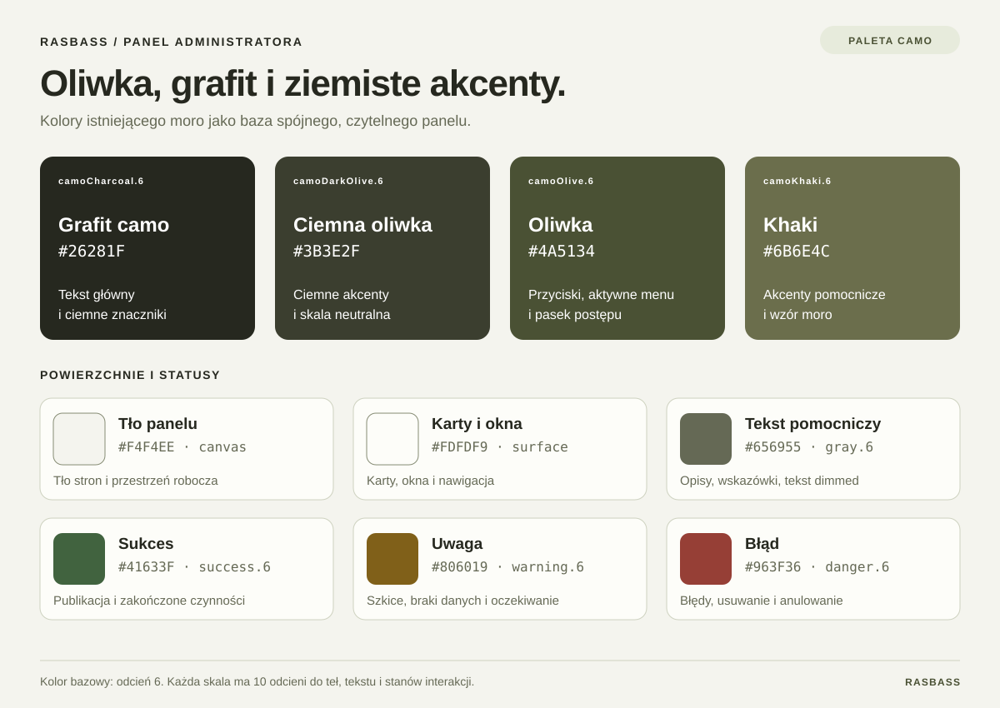

# Paleta admina RasBass

Panel korzysta z czterech kolorów istniejącego wzoru moro oraz jasnych, oliwkowych powierzchni. Głównym kolorem akcji jest oliwka; statusy mają osobne ziemiste odcienie.

| Rola             | Token                   | Kolor bazowy | Zastosowanie                                     |
| ---------------- | ----------------------- | ------------ | ------------------------------------------------ |
| Grafit camo      | `camoCharcoal.6`        | `#26281f`    | Tekst główny, ciemne znaczniki, wzór moro        |
| Ciemna oliwka    | `camoDarkOlive.6`       | `#3b3e2f`    | Ciemne akcenty i skala neutralna, wzór moro      |
| Oliwka           | `camoOlive.6`           | `#4a5134`    | Przyciski, aktywna nawigacja, postęp, informacje |
| Khaki            | `camoKhaki.6`           | `#6b6e4c`    | Akcenty pomocnicze i wzór moro                   |
| Tło panelu       | `adminSurfaces.canvas`  | `#f4f4ee`    | Tło stron                                        |
| Powierzchnia     | `adminSurfaces.surface` | `#fdfdf9`    | Karty, okna i nawigacja                          |
| Tekst pomocniczy | `gray.6`                | `#656955`    | Opisy, wskazówki, tekst `dimmed`                 |
| Sukces           | `success.6`             | `#41633f`    | Publikacja, wysyłka, zakończone czynności        |
| Uwaga            | `warning.6`             | `#806019`    | Szkice, braki danych, oczekiwanie                |
| Błąd             | `danger.6`              | `#963f36`    | Błędy, usuwanie, anulowanie i braki stanu        |

Każda skala zawiera 10 odcieni: 0–2 do jasnych teł, 6 jako kolor bazowy i 7–9 do ciemniejszych wariantów. Białe pola formularzy (`#ffffff`) oddzielają się od kremowego tła; ich obramowanie pochodzi z `gray.5` (`#858b73`). Stan powinien być opisany etykietą lub ikoną, aby sam kolor nie był jedyną informacją.

Sprawdzone kontrasty: tekst główny na tle panelu 13,53:1, tekst pomocniczy 5,13:1, jasny tekst na przyciskach co najmniej 5,71:1, tekst na jasnych plakietkach co najmniej 9,96:1. Obramowania pól mają kontrast 3,54:1 względem białego pola i 3,20:1 względem tła panelu. Kolory fokusu i błędu sprawdzono również na wyrenderowanych polach Mantine.

Źródła: [kolory moro](../apps/admin/src/lib/camo-colors.json), [skale i powierzchnie](../apps/admin/src/lib/admin-palette.ts), [motyw panelu](../apps/admin/src/lib/theme.ts). Próbki pokazują odcienie bazowe; warianty `light`, `outline` i stany najechania korzystają z odpowiednich odcieni skali.
